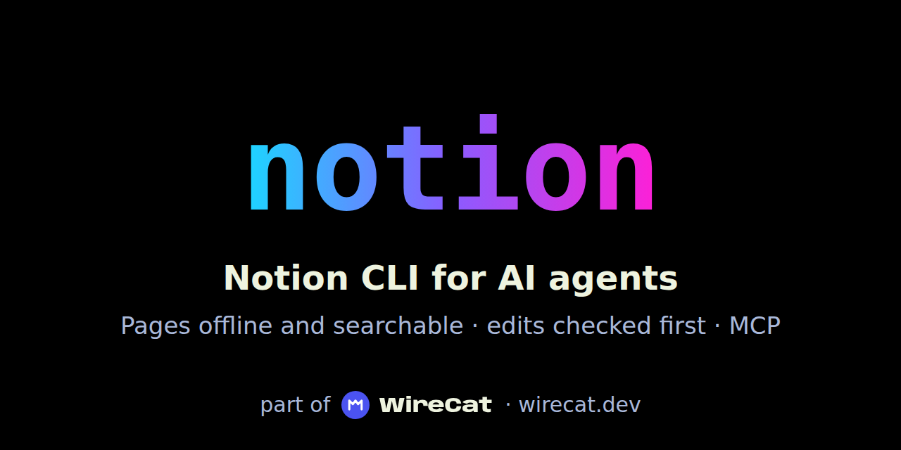

<p align="center">
  
</p>

# notion: Notion CLI and MCP server for AI agents

<p align="center">
  Find anything in your Notion without opening it. Ask Claude, ChatGPT, Codex or any AI agent, and it answers from a
  copy of your pages and databases on your computer, even offline, and edits a page without losing anyone's changes.
</p>

<p align="center">
  <a href="https://wirecat.dev/en/docs/notion">Docs</a> ·
  <a href="https://wirecat.dev/en/docs/notion/installation">Install</a> ·
  <a href="https://github.com/WireCatLabs/notion-cli/blob/main/docs/usage.md">Usage</a> ·
  <a href="https://discord.gg/DebENqbRrJ">Discord</a>
</p>

<p align="center">
  <a href="https://www.npmjs.com/package/@wirecat/notion-cli"></a>
  <a href="https://github.com/WireCatLabs/notion-cli/blob/main/LICENSE"></a>
</p>

- **Ask instead of searching.** "What did we decide about the pricing page?" gets an answer in a second, in Claude
  Code, Codex, Claude Desktop or any app that speaks MCP.
- **Your workspace, offline.** Pages, databases and their rows are copied to your computer and searched there, with
  no request to Notion.
- **Edits that respect your team.** An agent changes only the words it was asked to, and the edit is refused when
  someone changed the page since the agent read it.

## What you get

- **The answer, not the search.** Ask about a page in your own words. The agent finds it with its place in your
  workspace and its comments.
- **What changed since yesterday.** Pages added, changed or deleted, and every earlier version of a synced page.
- **Tasks in your databases.** Add a row with checked values, move it to Done, or list the open ones live.
- **Your meeting notes with your other meetings.** Notion AI meeting notes, with the summary and the transcript, sit
  beside your Zoom calls.
- **Pages from your notes.** Make a page from a Markdown file, move it, rename it, or comment on it.

```text
You:    What did we decide about the pricing page?
Agent:  (runs notion personal search "pricing page", then documents show on the top hit)
        The "Website 2027" page says the pricing page moves to three plans, decided on 12 November.
You:    Change "Due Friday" to "Due Monday" on that page.
Agent:  (runs notion personal documents update with the page's sha256 from when it read it)
        Done. The old text is kept in your local versions.
```

*Invented pages, illustrative output.*

## Why notion

- **A copy of your Notion on your computer.** `sync` copies the pages, the pages under them, the databases and their
  rows into a local store. Search and lists answer from it with no request to Notion, also offline.
- **Nothing is written over.** A targeted edit is checked against the text the agent read, and every text write keeps
  the text it replaced in your local versions.
- **A page that disappears is not lost.** A page no longer shared with the token is marked no longer visible and keeps
  its text in the copy. A deleted page goes to Notion's trash, and `documents restore` brings it back.
- **The token stays in your system keyring.** It never appears in output, errors or run records, and is never taken
  as an argument.
- **Your pages beside your other context.** They sit in the same local store as your messages, mail, notes and
  meetings from the other WireCat tools, so one search covers all of them.
- **Free and open source.** Apache 2.0.

## Quick start

In [WireCat Desktop](https://wirecat.dev/en/download), add Notion from the tool list and paste a Notion token when it
asks. Or in a terminal:

```sh
npm install -g @wirecat/notion-cli
notion skill install                 # the agent skill, for Claude Code, Codex, Gemini CLI and OpenClaw
notion personal session start        # paste your Notion token
notion personal sync                 # copy the pages and databases the token sees
notion personal search "pricing page"
```

`personal` is a profile, a name you choose for one Notion account. It is the first word of every command that uses an
account, and none is ever assumed.

**The token.** A [personal access token](https://developers.notion.com/guides/connections-and-tokens/personal-access-tokens)
acts with your own rights. An internal connection's token sees only the pages you share with that connection.
`session start` asks for it without showing it, checks it with Notion and keeps it in the system keyring.

You need Node.js 22.16 or a later 22.x, or Node.js 24 or later. `notion doctor` needs no network and shows what is set
up.

More: [installation and sign-in, step by step](https://github.com/WireCatLabs/notion-cli/blob/main/docs/installation.md)

## Use it with your agent

Ask in plain words. The agent picks the commands.

> *"Use notion. What changed in our Notion since yesterday?"*
> *"Use notion. Add a task to the Roadmap database: write the plan, owner me, status Open."*

- **Claude Code, Codex, Gemini CLI** and other agents with a terminal run `notion` themselves.
  `notion skill install` teaches them how.
- **Claude Desktop, Cursor** and other MCP apps connect to the Notion MCP server, `notion personal mcp serve`.

```sh
notion personal mcp add claude-code --allow-writes   # or: codex
notion personal mcp config                           # the entry for Claude Desktop, Cursor and others
```

More: [using notion](https://github.com/WireCatLabs/notion-cli/blob/main/docs/usage.md)

## What it can do

### Find and read

```sh
notion personal search "pricing page"                 # the copy, offline
notion personal documents get https://www.notion.so/Roadmap-0123456789abcdef0123456789abcdef
notion personal changes --since 1d                    # what changed in your Notion since yesterday
notion personal documents history 0123456789abcdef0123456789abcdef   # the earlier versions of a synced page
```

### Edit pages

```sh
notion personal documents update 0123456789abcdef0123456789abcdef \
  --payload '[{"old": "Due Friday", "new": "Due Monday"}]' \
  --expected-fingerprint 9f86d081884c7d659a2feaa0c55ad015a3bf4f1b2b0b822cd15d6c15b0f00a08
notion personal documents create --parent 0123456789abcdef0123456789abcdef --file notes.md
notion personal documents move 00112233445566778899aabbccddeeff --parent 0123456789abcdef0123456789abcdef
notion personal documents delete 00112233445566778899aabbccddeeff   # to Notion's trash, after asking
```

### Databases and rows

```sh
notion personal databases list
notion personal documents create --into fedcba9876543210fedcba9876543210 \
  --title "Write the plan" --field Status=Open --field Owner=me
notion personal documents update 00112233445566778899aabbccddeeff --field Status=Done
notion personal rows list fedcba9876543210fedcba9876543210 --filter Status=Open
```

### Comments and meeting notes

```sh
notion personal comments list 0123456789abcdef0123456789abcdef
notion personal comments create 0123456789abcdef0123456789abcdef --text "Looks good"
notion personal meetings sync                         # Notion AI meeting notes into WireCat's meetings
notion personal meetings list
```

The ids and the sha256 above are invented. Use the ones `search`, `databases list` and `documents get` print. A page's
link works wherever its id does.

More: [every command](https://github.com/WireCatLabs/notion-cli/blob/main/docs/commands.md)

## How it works

- **A Notion token.** You make it in Notion. It is kept in the system keyring, or in a private file with
  `--credential-storage file`.
- **A local copy.** `sync` copies everything the token sees, or only the pages and databases you choose with
  `folders add`. `folders browse` shows what there is to choose, one level at a time.
- **Writes go to Notion first.** A write changes Notion, then the copy. `--dry-run` shows what a write would do and
  sends nothing.
- **Made for scripts.** `--json` prints one JSON value for every command, and an error comes as JSON with a code to
  branch on.

## Settings and permissions

Each profile has a level for every command: `allow`, `ask`, `readonly` or `deny`. Deleting a page or a comment asks
first, and an update that would delete a child page or database needs `--allow-deleting-content`.

```sh
notion personal config show                           # each setting and where it came from
```

The token's variable is `WCNOTION_TOKEN`, not `NOTION_TOKEN`. Notion's own MCP server reads that one, and a token set
for it must not sign this tool in.

More: [settings](https://github.com/WireCatLabs/notion-cli/blob/main/docs/configuration.md)

## Limits

- Notion has no conditional write. The page is read again just before an edit, but an edit that lands after that read
  is not caught.
- Notion's API gives no resolved comments, so `comments list` shows the open ones.
- Keeping a folder of Markdown files in step with a Notion page tree is not there yet.
- Before 1.0, a minor version may change commands, `--json` fields and MCP tools. The changelog lists each such
  change under "may break callers".

## Security

The token can read what your Notion user or connection can, so `notion` keeps it in the system keyring and never
prints it, in output, errors or run records. Text from Notion is marked as untrusted, so an agent reads a page as
data, not as an instruction.

More: [security](https://github.com/WireCatLabs/notion-cli/blob/main/docs/security.md) · Report a vulnerability:
[SECURITY.md](https://github.com/WireCatLabs/notion-cli/blob/main/SECURITY.md)

## When something goes wrong

```sh
notion doctor                           # what is set up, without connecting
notion personal session status --check  # asks Notion whose token it is
```

More: [troubleshooting](https://github.com/WireCatLabs/notion-cli/blob/main/docs/troubleshooting.md) · Ask on
[Discord](https://discord.gg/DebENqbRrJ) · Bugs go to this repository's
[issues](https://github.com/WireCatLabs/notion-cli/issues).

## Documentation

Everything is in [docs/](https://github.com/WireCatLabs/notion-cli/blob/main/docs/index.md): installation, usage,
settings, security and the command reference.

## Development

You need Node.js 22.16 or a later 22.x, or Node.js 24 or later, and pnpm.

```sh
pnpm install && pnpm test
```

The CLI was started from [cli-template](https://github.com/WireCatLabs/cli-template). The order of work is in
[the design](https://github.com/WireCatLabs/notion-cli/blob/main/docs/dev/DESIGN.md), and the working rules are in
[AGENTS.md](https://github.com/WireCatLabs/notion-cli/blob/main/AGENTS.md).

## Part of WireCat

`notion` is one of the [WireCat](https://wirecat.dev) tools: open-source, local-first command-line tools that give AI
agents your context from messengers, mail, calendars, CRMs and documents. Each one works on its own.

## License

[Apache 2.0](https://github.com/WireCatLabs/notion-cli/blob/main/LICENSE)
